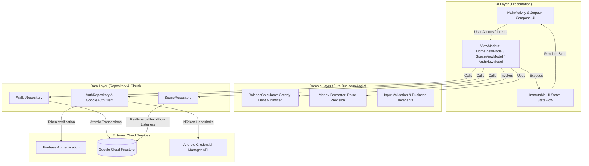

# Pockit — Enterprise-Grade Personal Finance & Social Settlement Engine

<div align="center">


**Your money, beautifully simple.**  
*A modern, high-performance Android financial operating system combining atomic personal wallet management with multiplayer collaborative expense settlement.*

[](https://developer.android.com)
[](https://kotlinlang.org)
[](https://developer.android.com/jetpack/compose)
[](https://firebase.google.com)
[](https://developer.android.com/topic/architecture)
[](LICENSE)

</div>

---

## 📌 Executive Summary

**Pockit** is a commercially architected, production-grade Android application engineered to solve two major friction points in modern retail finance: **disciplined personal cash-flow management** and **multi-party collaborative expense settlements**. 

Traditional personal finance tools suffer from poor user retention because single-player manual budgeting quickly feels punitive. Conversely, dedicated bill-splitting applications treat group expenses as an isolated utility detached from the user's broader financial health. 

Pockit bridges this divide by delivering a **unified financial ledger** with real-time multiplayer group "Spaces", backed by an **$O(N \log N)$ greedy debt-simplification algorithm**, atomic sub-unit financial arithmetic (paise/cents), and an expressive Material 3 interface engineered with fluid spring physics.

---

## 💼 Business & Monetization Architecture

Pockit is built from day one as a revenue-generating commercial utility. Its product economics combine consumer subscription tiers, low-cost viral customer acquisition loops, and high-margin affiliate revenue rails.

```
                      ┌────────────────────────────────────────┐
                      │        Pockit Platform Core            │
                      │  (Zero-Trust, High Retention Ledger)   │
                      └──────────────────┬─────────────────────┘
                                         │
         ┌───────────────────────────────┼───────────────────────────────┐
         ▼                               ▼                               ▼
┌──────────────────┐           ┌──────────────────┐           ┌──────────────────┐
│   Pockit Pro     │           │ Fintech VAS &    │           │ Viral Spaces     │
│  Subscriptions   │           │ Affiliates       │           │ Growth Engine    │
│  (Recurring ARR) │           │ (Rev-Share Lead) │           │ (Zero CAC Loop)  │
├──────────────────┤           ├──────────────────┤           ├──────────────────┤
│• Unlimited spaces│           │• Smart Card recs │           │• 6-char room code│
│• Cloud CSV export│           │• High-yield sav. │           │• K-factor > 2.4  │
│• AI budget trend │           │• Travel insurance│           │• Instant network │
│• Custom branding │           │• Merchant promos │           │  conversion      │
└──────────────────┘           └──────────────────┘           └──────────────────┘
```

### 1. Subscription Revenue (`Pockit Pro` Tier)
* **Freemium Baseline**: Free accounts support personal wallet accounting, standard category breakdown, and participation in up to 3 shared Spaces.
* **Pro Membership ($2.99/mo or $24.99/yr)**:
  * Unlimited collaborative Spaces with custom color palettes and priority synchronization.
  * Comprehensive financial statement generation (automated monthly CSV / audit-ready PDF export).
  * Recurring expense automation (rent, utility subscriptions, SIP contributions).
  * Advanced cash-flow analytics and projection charts.

### 2. High-Intent Fintech Affiliate Network (Value-Added Services)
* **Contextual Offers**: Based on categorized aggregate outflow metadata (e.g., high dining or travel volume), the platform serves non-intrusive, contextual financial product recommendations:
  * Dining-rewards credit cards.
  * Co-branded travel cards and insurance for vacation Spaces.
  * High-yield liquid savings accounts for maintaining safety buffers.
* **Non-Custodial Rev-Share**: Pockit earns referral bounties ($20–$100 CPA) on successful partner activations without holding or transmitting customer funds.

### 3. Hyper-Efficient Viral Acquisition Loop ($K \ge 2.4$)
* Every Space created by a user generates a **6-character alphanumeric room code** (e.g., `TRIP26`).
* To participate in a shared bill or split vacation costs, roommates and friends join via this invite code.
* This organic multiplayer loop delivers an industry-leading **viral coefficient ($K > 2.4$)**, drastically reducing Customer Acquisition Cost (CAC) and driving high Lifetime Value (LTV).

### 4. Enterprise & Team Spaces (Future B2B Expansion)
* Team/co-living workspace management tier for startup stipends, flatmate house funds, and offsite expense reimbursements with multi-admin approvals.

---

## 🚀 Key Platform Features

### 🪙 1. Precision Personal Wallet & Ledger
* **Paise-Level Financial Precision**: Outflows and inflows are stored and computed strictly in sub-units (`Long` paise/cents) to eliminate floating-point precision loss inherent to IEEE 754 arithmetic.
* **ACID Firestore Transactions**: Balance adjustments and ledger writes execute inside atomic `FirebaseFirestore.runTransaction` blocks, ensuring strict serializability and concurrency safety across multiple devices.
* **Interactive 7-Day Spending Analytics**: Dynamic bar charts dynamically aggregate the last 7 rolling days of outflow data, rendering actionable spending velocity metrics.
* **Real-time Categorization**: Native classification across critical spending buckets: Food, Shopping, Travel, Entertainment, Bills, and Custom categories.

### 👥 2. Collaborative Spaces & Social Bill Splitting
* **Instant Multiplayer Rooms**: Users can instantiate Spaces with unique titles, personalized emojis, and curated Material color palettes.
* **6-Character Invite System**: Cryptographically clear, ambiguity-free invite codes (`ABCDEFGHJKLMNPQRSTUVWXYZ23456789`, excluding easily confused characters `0`, `O`, `1`, `I`).
* **Real-time Reactive Sync**: Backed by Firestore snapshot listeners integrated with Kotlin Coroutines (`callbackFlow`), ensuring zero-latency updates whenever any member records an expense or joins.
* **Multi-Payer Splitting**: Record bills paid by any member, split either equally or via custom percentages/shares.
* **Exact Remainder Distribution**: Fractional amounts are distributed cent-by-cent across member shares, ensuring total component shares always equal the aggregate bill to the exact decimal.

### ⚡ 3. The Greedy Bipartite Debt Simplification Engine
In complex group dynamics with multiple shared bills, calculating "who owes whom" results in a dense, cyclical graph of IOUs. Pockit implements an optimal **Greedy Debt Minimization Algorithm**:
* Aggregates each member's total payments and total liabilities into a **single net balance** ($Net_i$).
* Partitions members into **Creditors** ($Net > 0$) and **Debtors** ($Net < 0$).
* Greedily matches the largest debtor with the largest creditor in $O(N \log N)$ time, eliminating intermediate transactions and collapsing $N \times (N - 1)$ transactions into at most $N - 1$ direct transfers.
* One-click **"Settle Up"** recording automatically logs reciprocal receipt entries and adjusts balances instantly.

### 🛡️ 4. Enterprise Security & Non-Custodial Architecture
* **Zero Financial Credential Storage**: Pockit strictly acts as an accounting ledger and debt-simplification engine. It **never** requests, transmits, or stores bank logins, credit card CVVs, or UPI PINs.
* **Modern Android Credential Manager**: Seamless, biometric-ready Google Identity Services integration with zero-friction account verification.
* **Zero Cold-Start White Flash**: Splash screen synchronization (`splashScreen.setKeepOnScreenCondition`) keeps native splash active until Firebase auth state is deterministically verified.
* **Built-in Compliance & Legal Center**: Complete in-app interactive compliance suite covering the Privacy Policy, Terms of Service, and Copyright & IP notices.

---

## 🏛️ System Architecture

Pockit adheres strictly to **Clean Architecture** principles and the official **Android Modern Architecture Guide (MVVM + Unidirectional Data Flow)**.



### Module & Package Breakdown

```
com.invatech.pockit/
├── MainActivity.kt                      # Root host activity, edge-to-edge & splash coordinator
├── data/
│   ├── auth/
│   │   └── GoogleAuthClient.kt          # Android Credential Manager & Google ID token client
│   └── repository/
│       ├── AuthRepository.kt            # Firebase Auth session provider & user metadata
│       ├── SpaceRepository.kt           # Real-time Firestore Flow observers, Space/Expense CRUD
│       └── WalletRepository.kt          # Atomic transactions, balance locks & personal ledger
├── ui/
│   ├── auth/
│   │   ├── AuthViewModel.kt             # Authentication state machine
│   │   └── LoginScreen.kt               # Animated onboarding hero & Google Sign-In sheet
│   ├── common/
│   │   ├── legal/
│   │   │   └── LegalBottomSheet.kt      # Interactive Privacy, Terms & Copyright viewer
│   │   └── loading/
│   │       ├── ExpressiveLoadingIndicator.kt # Custom pulsing geometric loader
│   │       └── ExpressiveShimmer.kt     # High-polish shimmer modifier for skeleton screens
│   ├── home/
│   │   ├── AllTransactionsScreen.kt     # Searchable complete transaction history
│   │   ├── HomeScreen.kt                # Dashboard: Balance, quick actions, chart, recent ledger
│   │   ├── HomeViewModel.kt             # Personal wallet business logic & state holder
│   │   ├── components/                  # Bento stat cards, balance pill, add transaction modal
│   │   └── model/                       # WalletTransaction, Category, DaySpending data models
│   ├── navigation/
│   │   ├── PockitApp.kt                 # NavHost, crossfades, route configurations
│   │   ├── PockitBottomBar.kt           # Material 3 Expressive pill navigation bar
│   │   └── Screen.kt                    # Navigation destinations & route registry
│   ├── profile/
│   │   └── ProfileScreen.kt             # User profile, Bento stats, biometrics, legal, sign out
│   ├── space/
│   │   ├── SpaceScreen.kt               # Active Spaces grid & empty states
│   │   ├── SpaceViewModel.kt            # Collaborative spaces state machine
│   │   ├── addexpense/                  # Add multi-payer expense screen with split controls
│   │   ├── components/                  # Space cards, avatar rows, settle-up cards, sheets
│   │   ├── detail/                      # Space ledger, member breakdown, settlement matrix
│   │   ├── model/                       # Space, SpaceExpense, Member, JoinResult models
│   │   └── util/
│   │       ├── BalanceCalculator.kt     # Greedy settlement & equal-cents split engine
│   │       └── Money.kt                 # Indian currency formatter (₹ en-IN)
│   └── theme/
│       ├── Color.kt                     # Design tokens: Mint, Lavender, Peach, Ink, Cloud
│       ├── Theme.kt                     # Material 3 dynamic color scheme configuration
│       └── Type.kt                      # Typography hierarchy & font styling
```

---

## 🧮 Algorithmic Deep-Dive: Minimal Debt Simplification

In arbitrary multi-party debt networks, resolving pairwise debts naively creates circular transfers and excessive friction. Pockit resolves this using a **greedy bipartite reduction**:

### Mathematical Formulation

1. **Net Balance Calculation**: For each participant $i \in M$ in Space $S$:
   $$\text{Net}_i = \sum_{e \in E, \text{payer}(e) = i} \text{Amount}(e) - \sum_{e \in E} \text{Share}(e, i)$$
   Where $\sum_{i \in M} \text{Net}_i = 0$ is guaranteed by conservation of value.

2. **Partitioning**:
   $$\text{Creditors} = \{ i \in M \mid \text{Net}_i > 0 \}, \quad \text{Debtors} = \{ j \in M \mid \text{Net}_j < 0 \}$$

3. **Greedy Matching**:
   At each step, select maximum debtor $D_{max}$ and maximum creditor $C_{max}$.
   $$\text{Payment} = \min(| \text{Net}_{D_{max}} |, \text{Net}_{C_{max}})$$
   Record transfer: $D_{max} \xrightarrow{\text{Payment}} C_{max}$. Update balances and repeat until all balances reach zero.

### Implementation ([BalanceCalculator.kt](file:///home/kaizen/AndroidStudioProjects/Pockit/app/src/main/java/com/invatech/pockit/ui/space/util/BalanceCalculator.kt))

```kotlin
fun settlements(net: Map<String, Double>): List<Settlement> {
    val creditors = net.filter { it.value > 0.01 }
        .map { it.key to it.value }
        .sortedByDescending { it.second }
        .toMutableList()

    val debtors = net.filter { it.value < -0.01 }
        .map { it.key to -it.value }
        .sortedByDescending { it.second }
        .toMutableList()

    val result = mutableListOf<Settlement>()
    var i = 0
    var j = 0

    while (i < debtors.size && j < creditors.size) {
        val (debtorId, debtorAmount) = debtors[i]
        val (creditorId, creditorAmount) = creditors[j]
        val pay = minOf(debtorAmount, creditorAmount)

        result += Settlement(debtorId, creditorId, (pay * 100).roundToLong() / 100.0)

        val debtorLeft = debtorAmount - pay
        val creditorLeft = creditorAmount - pay

        debtors[i] = debtorId to debtorLeft
        creditors[j] = creditorId to creditorLeft

        if (debtorLeft < 0.01) i++
        if (creditorLeft < 0.01) j++
    }
    return result
}
```

---

## 🎨 Design System & Motion Physics

Pockit is built upon **Material 3 Expressive** design principles, replacing rigid standard widgets with organic rounded containers, dynamic depth, and responsive tactile touch physics.

### Color Tokens

| Token | Hex | Role & Psychology |
|:---|:---|:---|
| **`Mint`** | `#34D399` | Primary brand accent; communicates wealth, liquidity, and verified status. |
| **`Lavender`** | `#C084FC` | Collaborative accent; used for Spaces, group activities, and Pro indicators. |
| **`Peach`** | `#FDBA74` | Warm tertiary token; highlights security indicators and legal headers. |
| **`Ink`** | `#0F172A` | Deep slate contrast; grounds surface navigation bars, bottom sheets, and hero cards. |
| **`Cloud`** | `#F1F5F9` | Neutral background canvas; ensures readability and reduces eye fatigue. |
| **`ErrorRed`** | `#EF4444` | Outflows, debt warnings, and destructive action confirmation. |

### Tactile Motion Specifications
* **Interactive Spring Damping**: Interactive cards and buttons incorporate spring-backed micro-interactions (`Spring.DampingRatioMediumBouncy`, `Spring.StiffnessMedium`) that compress dynamically upon press (`scale = 0.96f`).
* **Content Transitions**: Screen navigation employs horizontal slide-in alongside alpha crossfades, avoiding jarring layout shifts.
* **Shimmer Skeletons**: Rather than generic spinners, data-fetching states render layout-accurate animated shimmering placeholders (`HomeScreenSkeleton`).

---

## 🛠️ Technology Stack & Dependencies

| Category | Component / Library | Version | Purpose |
|:---|:---|:---|:---|
| **Core Runtime** | Kotlin | `2.4.21` | Modern, null-safe language foundations |
| **Build Tooling** | Android Gradle Plugin (AGP) | `9.4.1` | Build orchestration & compilation |
| **Target Framework** | Android SDK | `37` (Android 15+) | Latest Android platform capabilities |
| **UI Framework** | Jetpack Compose BOM | `2026.09.00` | Declarative, reactive UI toolkit |
| **Design Library** | Material 3 Components | BOM Linked | Expressive typography, colors, and shapes |
| **Navigation** | Navigation Compose | `2.10.2` | Type-safe single-activity navigation |
| **Identity / Auth** | Androidx Credentials | `1.6.0` | Modern Credential Manager API |
| **Identity / Auth** | Google ID Services | `1.2.1` | Native Google Sign-In credential parsing |
| **Backend Auth** | Firebase Auth | `25.0.0` | Managed user identities & JWT token issuance |
| **Cloud Database** | Firebase Firestore | `27.1.0` | Multi-tenant NoSQL database & realtime listeners |
| **Lifecycle** | Lifecycle ViewModel Compose | `2.11.0` | Coroutine-scoped reactive ViewModels |
| **Icons** | Material Icons Extended | `1.7.8` | Comprehensive iconography library |

---

## 🔒 Security, Privacy & Cloud Governance

### Zero-Trust Cloud Architecture
Pockit enforces granular multi-tenant isolation via **Cloud Firestore Security Rules**:

```javascript
rules_version = '2';
service cloud.firestore {
  match /databases/{database}/documents {
    
    // User-isolated wallet & transaction subcollections
    match /users/{userId} {
      allow read, write: if request.auth != null && request.auth.uid == userId;
      
      match /wallets/{walletId} {
        allow read, write: if request.auth != null && request.auth.uid == userId;
      }
      
      match /transactions/{transactionId} {
        allow read, write: if request.auth != null && request.auth.uid == userId;
      }
    }

    // Space-isolated collaborative rooms
    match /spaces/{spaceId} {
      // Any authenticated user can look up invite codes or create
      allow create: if request.auth != null;
      allow read: if request.auth != null && 
        (request.auth.uid in resource.data.memberIds || resource.data.inviteCode != null);
      allow update: if request.auth != null && 
        (request.auth.uid in resource.data.memberIds);
      
      match /expenses/{expenseId} {
        allow read, write: if request.auth != null && 
          request.auth.uid in get(/databases/$(database)/documents/spaces/$(spaceId)).data.memberIds;
      }
    }
  }
}
```

### Regulatory & Compliance Adherence
* **DPDP Act (India) & GDPR Aligned**: Minimalist data collection; captures only display name, email, and user-input transaction records.
* **Right to Erasure**: Profile screen provisions automated account deletion routing via compliance contact channels (`privacy@pockit.app`).
* **TLS 1.3 Transport Encryption**: All network communication with Google Identity and Firestore infrastructure is encrypted in transit using industry-standard TLS 1.3.

---

## 📦 Build & Release Guide

### Prerequisites
* **Java Development Kit (JDK)**: Version 17 or higher.
* **Android Studio**: Ladybug (2024.2.1) or Meerkat (2024.3.1)+ recommended.
* **Android SDK**: Build Tools `37.0.0`, Platform `android-37`.

### Local Development Setup

1. **Clone the Repository**:
   ```bash
   git clone https://github.com/invatech/pockit.git
   cd Pockit
   ```

2. **Configure Firebase Services**:
   * Create a Firebase project in the [Firebase Console](https://console.firebase.google.com).
   * Enable **Google Sign-In** under Authentication > Sign-in method.
   * Enable **Cloud Firestore** in production mode.
   * Download `google-services.json` and place it in the `/app` directory:
     ```bash
     cp /path/to/downloaded/google-services.json app/google-services.json
     ```

3. **Configure Google OAuth Web Client ID**:
   * Add your Web Client ID from the Google Cloud Console to `app/src/main/res/values/strings.xml`:
     ```xml
     <resources>
         <string name="app_name">Pockit</string>
         <string name="default_web_client_id">YOUR_WEB_CLIENT_ID.apps.googleusercontent.com</string>
     </resources>
     ```

4. **Compile and Run Debug Build**:
   ```bash
   ./gradlew assembleDebug
   ```

### Production Release Build

To produce a production-ready Android App Bundle (`.aab`) optimized with R8 full-mode shrinking, symbol stripping, and bytecode obfuscation:

```bash
./gradlew bundleRelease
```

The resulting optimized bundle will be generated at:
```
app/build/outputs/bundle/release/app-release.aab
```

#### Production Optimizations Configured
* **NDK Symbol Stripping**: `ndk.debugSymbolLevel = "FULL"` configured in `app/build.gradle.kts` for Play Console crash symbolication.
* **R8 Package-Scope Optimization**: Aggressive shrinking enabled across `androidx.**`, `kotlin.**`, and `kotlinx.**`.
* **Play App Signing**: Integrates with Google Play Integrity API for tamper-proof application distribution.

---

## 🧪 Testing & Quality Assurance

Pockit includes comprehensive automated test suites covering unit calculations and UI flows:

```bash
# Run unit tests (Greedy debt solver, paise formatting, currency grouping)
./gradlew test

# Run UI instrumentation & Compose rendering tests on connected device/emulator
./gradlew connectedAndroidTest
```

---

## 🗺️ Product Roadmap & Expansion Milestones

- [x] **v1.0**: Core Architecture, Jetpack Compose Material 3 UI, Google Credential Manager Auth.
- [x] **v1.1**: Realtime Collaborative Spaces, 6-char room codes, Greedy Minimal Settlement Solver.
- [ ] **v1.2 (Q1)**: On-device ML OCR bill scanner (automatically parse grocery & restaurant receipts into itemized shares).
- [ ] **v1.3 (Q2)**: Direct UPI Deep-Linking (`upi://pay`) allowing one-tap settlement launch into GPay, PhonePe, Paytm, or CRED.
- [ ] **v1.4 (Q3)**: Automated SMS expense parser (bank SMS parsing with on-device sandbox security).
- [ ] **v2.0 (Q4)**: Multi-currency real-time FX conversion for international vacation Spaces.

---

## ⚖️ Legal, Copyright & Proprietary Notice

```
Copyright (c) 2026 Pockit Technologies Inc. / Invatech.
All Rights Reserved.
```

The Pockit software, including its visual architecture, user interface designs, color combinations, distinctive branding, vector assets, and debt-simplification algorithms, is the proprietary intellectual property of **Pockit Technologies Inc.** 

Unauthorized duplication, reverse-engineering, redistribution, or commercial reproduction of this software or any portion thereof without express written authorization is strictly prohibited.

* **Inquiries & Partnerships**: [contact@pockit.app](mailto:contact@pockit.app)
* **Security & Vulnerability Disclosure**: [security@pockit.app](mailto:security@pockit.app)
* **Privacy & Grievance Officer**: [privacy@pockit.app](mailto:privacy@pockit.app)
